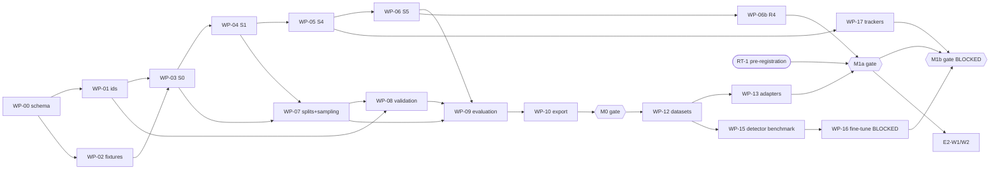

# Package F — Implementation-Agent Handoff (RQ1)

**Date:** 8 November 2026
**Builds on:** *RQ1 Contract Reference E-1.2.1 (FROZEN)*, the only contract agents implement from. Methodology: C.1, D, D.1.
**Scope:**
- **M0:** deterministic contract verification.
- **M1:** single-camera synthetic E1 vertical slice, split into M1a (oracle perception) and M1b (detector-based).
- Defined but not on the critical path:
  - E2 measurement workstream.
  - M2 multi-camera.
  - Real-data track (D-4).
  - FM-X1.

**Not in scope:** live video, multi-site orchestration, the human-assistance study (D-5), safety scores, OSHA linkage.

---

## 1. Status model and reporting rules

| Status | Meaning | Evidence | Who sets it |
|---|---|---|---|
| **Implemented** | The module produces the specified outputs on its inputs | Module runs on fixtures; outputs schema-valid | Implementing agent |
| **Verified** | Its contract and integration tests pass | Test report with fixture hashes and artifact IDs; re-run reproduces them | Integration agent (WP-11, WP-14, WP-18) |
| **Empirically validated (scope)** | Independent reference evaluation supports a stated measurement claim, in a stated scope | `metric_result` and `measurement_fitness` records; scope names the data origin | Researcher, from S8/S8f output |

Rules:
- The three statuses are tracked separately on the status board (§10) and never merged.
- **Synthetic-scope validation supports engineering-feasibility claims (claims-ladder Levels 1–2) only.** By contract, no output reaches `technically_validated` in M0 or M1 (it requires real footage).
- Report wording:
  - Automated outputs are "candidate", "suspected" or "undetermined".
  - Populations "passed the available leakage screening".
  - Event counts are "scenario counts".
  - Test-only parameter values are never quoted as findings.

---

## 2. Ground rules for implementation agents

| Topic | Rule |
|---|---|
| Contract | Implement from E-1.2.1 only. A gap or conflict is a change request (§9), never a local decision |
| Language and layout | Python 3.11+; modular monolith; one package per module: `rq1.ids`, `rq1.schema`, `rq1.registry`, `rq1.decode`, `rq1.perception`, `rq1.tracking`, `rq1.spatial`, `rq1.substrate`, `rq1.events`, `rq1.splits`, `rq1.sampling`, `rq1.validation`, `rq1.evaluation`, `rq1.fitness`, `rq1.export`, `rq1.adapters.<dataset>`, `rq1.fixtures`. Cross-module calls only through the §10.2 interfaces |
| Storage | Parquet (pyarrow) and JSON files in an artifact directory per `art_`. No database server |
| Dependencies | Base set: pyarrow, numpy, scipy (Hungarian via `linear_sum_assignment`), PyAV (frame PTS/DTS access), FFmpeg CLI (fixture clips), an RFC 8785 library, jsonschema, pytest, hypothesis, opencv-python-headless (geometry only). Detector and tracker libraries are confined to WP-15/WP-17 adapters. Every new dependency needs a CR and a `license_component` entry |
| Determinism | No wall-clock or randomness in payloads. Seeded RNG passed through configs. Inputs canonically sorted before any solver. IoU weights quantized to integer micro-units |
| Data handling | No identifiable footage leaves the working environment. No external inference services. Synthetic datasets are not redistributed |
| Done | A WP is *implemented* when outputs validate; *verified* only when all listed tests pass in the integration run |

---

## 3. TEST-ONLY parameter values

These values exist **only so that fixtures have known answers**. They are not research thresholds and must not appear in any result. Research values are pre-registered by the researcher (task RT-1, §8) before test-partition evaluation.

| Parameter | Test value | Used by |
|---|---|---|
| *k_sup* | 1.5 (δ_max = 50 ms at 30 fps) | CT-T-14–20, FX-CLIP-A–D |
| *f_untimed* / *f_sub* | 0.05 / 0.10 | CT-T-08, CT-T-17 |
| *g_max* | 15 frames | POW fixtures |
| *v_min* / *w_v* | 0.3 m/s / 0.5 s | FX-01–06 |
| *d_p* (R2) / *k_img* (R1) | 2.0 m / 0.05 | FX-01–07 |
| *d_pc* / *τ* (R3) | 1.0 m / 2.0 s | FX-03, FX-04 |
| *ttc_max* / *pet_max* (R4) | 1.5 s / 1.0 s | WP-06b fixtures |
| *e_turn* / *e_acc* / *e_dec* / *w_e* | 1.5 rad/s / 1.0 m/s² / 2.0 m/s² / 1.0 s | FX-05 (T5) |
| *m_gap* / *t_min* / *w_post* | 5 frames / 0.2 s / 1.0 s | Lifecycle fixtures |
| *d_nm* / *k_σ* / *k_c* / *o_max* | 0.5 m / 2.0 / 3.0 m/s² / 0.5 | FX-01–06 |
| Band edges | 0, 0.5, 1.0, 2.0, 4.0 m | Exposure fixtures |
| *iou_m* / *iou_cm* / *k_kf* | 0.3 / 0.5 / 1.0 s | Matching and CM fixtures |
| *w_ref* / *w_guard* / *n_min* | 30 s / 5 s / 10 | Sampling fixtures |
| *iou_rep* / *s_rep* | 0.95 / 0.01 | CT-I-02 |

Every test-only configuration record carries `version_label = "TEST-ONLY"`. The export and report generators refuse such configs (CT-F-11, added in WP-10).

---

## 4. Milestones

| Milestone | Delivers | Exit gate | Needs |
|---|---|---|---|
| **M0** Deterministic contract verification | All M0 tests pass; an end-to-end fixture run from clip and fixture tracks to evaluation and export is reproduced twice with identical artifact IDs | Gate M0 (WP-11) | No datasets, no detector, CPU only |
| **M1a** Oracle-perception slice | SDG near-miss and SmartSpaces (single camera) through S0→S9 with simulator-truth tracks; GV programme; BL-2/BL-3/BL-4/BL-6 on oracle perception (AB-3); reliability MR-01, MR-08–12; completeness | Gate M1a (WP-14) | WP-12 downloads (~1.5 GB, network access); CPU |
| **M1b** Detector slice | Same path with real perception; AB-1 benchmark; AB-2 trackers; error attribution with oracle substitution | Gate M1b (WP-18) | Direct-inference benchmark (ready); fine-tuning **blocked** on C2/C3/C4 |
| **E2-M** E2 measurement workstream | §6 | Gates E2-G1–G3 | SDG collision scenario; staged data for later gates |
| **M2** Multi-camera | Linkage, GPW, scenario counts | CT-L suite | Aligned timelines (SmartSpaces sync evidence) |
| **RD** Real-data track (parallel) | Acquisition, ethics, collection protocol | Approvals obtained | Not a prerequisite for M0/M1 |
| **FM-X1** Optional | Measured annotation-efficiency experiment | Separate approval | Real training footage |

---

## 5. Work packages

Each WP lists: goal; owner interface; prerequisites; non-goals; inputs → outputs (contract sections); acceptance tests; error cases; completion evidence; status.

### M0 — Deterministic contract verification

**WP-00 Foundation: schemas, validators, canonical JSON**

| | |
|---|---|
| Goal | One schema source generating Arrow schemas and JSON Schemas for every §5 table; validators for every active VR rule; JCS serialization; error-code registry |
| Interface | `rq1.schema.registry`, `rq1.schema.validate(artifact)` |
| Prereq | — |
| Non-goals | Business logic of any stage |
| I/O | Contract §1, §5, §10.3, §12.1 |
| Tests | CT-E-01, CT-E-05, CT-E-30; one passing and one failing fixture per VR rule |
| Errors | ERR-SCHEMA-MAJOR, ERR-UNKNOWN-ENUM; NaN, Inf and sentinel rejection |
| Evidence | Validator coverage report: every VR rule has a failing fixture |
| Status | **READY** |

**WP-01 Identity and artifact builder**

| | |
|---|---|
| Goal | Implements contract §2.3: specification hash, payload canonicalization, `art_`, record and FK IDs, manifest and execution files, reconstruction check |
| Interface | `rq1.ids.build_artifact(spec, tables) -> Artifact`; `rq1.ids.verify(artifact_dir)` |
| Prereq | WP-00 |
| Non-goals | Storage optimization |
| I/O | Contract §2 |
| Tests | CT-ID-01–07, CT-FK-01–07, CT-I-01, CT-I-03–08; reproduces the §2.3 reference values exactly |
| Errors | ERR-NATURAL-KEY, ERR-FK |
| Evidence | Reference-value test; shuffle and re-serialization tests |
| Status | **READY** |

**WP-02 Fixture factory**

| | |
|---|---|
| Goal | (a) Clip generator producing FX-CLIP-A–D, FX-10 and every CT-T clip: VFR, B-frames, duplicate PTS, stripped timestamps, corrupt packets, internal dropouts, two-file sessions with metadata. (b) Record-fixture builder for FX-01–16, FX-A3.1, FX-B*, FX-C*, FX-D*, with tracks and geometry designed to give the D.1 truth-table labels under §3 test values. (c) Fixture manifest with SHA-256 per fixture |
| Interface | `rq1.fixtures.build_all(out_dir)` |
| Prereq | WP-00 |
| Non-goals | Realism; a fixture exists to have a known answer |
| I/O | Contract §12.4 |
| Tests | Each fixture's expected-results file is checked by hand calculation (one worked calculation per fixture committed); the clip generator is deterministic (same bytes on re-run, given the same FFmpeg build) |
| Errors | Generator refuses a fixture whose expected values are inconsistent with the contract invariants |
| Evidence | Fixture manifest; expected-results files |
| Status | **READY** |

**WP-03 Registration, timelines, calibration (S0)**

| | |
|---|---|
| Goal | S0 artifacts: datasets, licences, sites, sessions (with lineage), cameras, source files, recordings, timelines, clock alignments, world frames, tiered calibrations, context maps |
| Interface | `Registrar.register` |
| Prereq | WP-01, WP-02 |
| Non-goals | Decoding |
| I/O | Contract §3.1, §4, §5.1 |
| Tests | FX-A3/A4, FX-B1–B3, CT-I-05, CT-I-06, VR-E-070, CB-01–02, TI-11 |
| Errors | ERR-CALIB-TIER on tier/field mismatch; duplicate registration rejected |
| Evidence | Test report |
| Status | **READY** |

**WP-04 Decode, timestamps, support, coverage (S1)**

| | |
|---|---|
| Goal | Resolve timestamps, eligibility and `reorder_depth`; support with capping, exclusion and uncertainty regions; coverage tiled per timeline and camera; `decode_summary` |
| Interface | `Decoder.decode` |
| Prereq | WP-03 |
| Non-goals | Image-quality model tuning (exclusion rules are configuration) |
| I/O | Contract §3.2–3.6, §5.3 |
| Tests | CT-T-01–13, CT-T-14–17 (frame-level and coverage parts), CT-T-20 (a, b), CT-E-04, TI-01–03, TI-06, TI-07, TI-09–13 |
| Errors | ERR-TIMESTAMPS; ERR-DECODE-FRAME recorded |
| Evidence | Property-test report (500 clips) |
| Status | **READY** |

**WP-05 Spatial measurement and substrate (S4) with oracle tracks**

| | |
|---|---|
| Goal | `OracleTrackSource` (fixture or simulator tracks → S3 artifact); geometry estimation (ground-plane homography, full camera, image-only), with σ and evidence classes; POW construction (bridging on eligible frames only, coverage-gap splits); pair series; exposure profiles; activity segments |
| Interface | `OracleTrackSource.tracks`, `GeometryEstimator.estimate`, `SubstrateBuilder.build` |
| Prereq | WP-04 |
| Non-goals | Real detectors and trackers; GPW (M2); E2 tables (E2-M) |
| I/O | Contract §3.4, §3.5, §4.2, §5.4, §5.5 |
| Tests | CT-E-06, CT-E-07, CT-E-08, CT-E-11, CT-F-01, CT-F-02, CT-T-14–19 (duration assertions), CT-T-20 (c, d), FX-D1/D2, TI-04, TI-05, TI-08, EC-01–05, CD-01–03, CB-03–05 |
| Errors | ERR-CALIB-MISSING (data_recorded), ERR-CALIB-FAILED, ERR-CALIB-TIER |
| Evidence | Test report; substrate artifact IDs |
| Status | **READY** |

**WP-06 Event engine (S5): R1, R2, R3, R5, contact assessor, labels**

| | |
|---|---|
| Goal | Flag providers R1, R2, R3, R5; the G and Q flags; lifecycle; contact state; D.1 labels; single-camera candidate events (all scenarios singleton); count summaries |
| Interface | `FlagProvider.flags`, `EventEngine.run` |
| Prereq | WP-05 |
| Non-goals | R4 (WP-06b); linkage (M2) |
| I/O | Contract §5.6, §6 |
| Tests | CT-E-09, CT-E-10 (D1-AC-01/02, property test over random flag sequences), CT-E-12 (substrate unchanged), CT-E-13 (one episode with two provider columns: use R3 plus a stub R4 provider), CT-E-14, FX-01–07, CL-INV-01–11, VR-E-034 |
| Errors | ERR-INVARIANT |
| Evidence | Truth-table report T1–T11 |
| Status | **READY** |

**WP-07 Splits, leakage audit, sampling (X0, V0)**

| | |
|---|---|
| Goal | Preliminary leakage groups from lineage; frozen split v1; RES and ECS sampling plans and window tiling; leakage audit; PR-01 revision; R-2 gate; R-3 resample and conditional reporting flags |
| Interface | `SplitBuilder.freeze/revise`, `LeakageAuditor.audit`, `ReferenceSampler.draw` |
| Prereq | WP-03, WP-04 |
| Non-goals | Choosing research strata (researcher, RT-1) |
| I/O | Contract §5.8 (plan, window), §5.9 (split, audit), §8 |
| Tests | CT-S-01–10, CT-E-18, CT-E-19, CT-E-23, D1-AC-09 (estimator coverage simulation), D1-AC-11, SP-01–11 |
| Errors | ERR-LEAKAGE, ERR-AUDIT-PENDING, ERR-ECS-AGGREGATE |
| Evidence | Simulation report: weighted intervals cover the known totals at about the nominal rate |
| Status | **READY** |

**WP-08 Validation store and simulator-reference converter**

| | |
|---|---|
| Goal | Validation-store tables; append-only status log with hash chain; namespace and label-source guards; `SimReferenceConverter` producing A and B layer references from truth, including object presence and coverage labels on eligible frames |
| Interface | `SimReferenceConverter.convert`; `validation.append_status` |
| Prereq | WP-01, WP-07 |
| Non-goals | Human annotation tooling (C5 provisional; real-data track) |
| I/O | Contract §5.8 |
| Tests | CT-E-24, CT-E-25, FX-13, VR-E-052, VR-E-053, VR-E-055 |
| Errors | ERR-NAMESPACE |
| Evidence | Hash-chain verification report |
| Status | **READY** |

**WP-09 Evaluation and fitness (S8, S8f)**

| | |
|---|---|
| Goal | Matching; event metrics EV-M1–12; weighted estimators and both bootstrap targets; completeness CM-01–10 on both support bases; error attribution (oracle factorial on synthetic; diagnostic on real); acceptance-criterion store; scoped fitness engine |
| Interface | `Matcher.match`, `Evaluator.evaluate`, `FitnessEngine.decide` |
| Prereq | WP-06, WP-07, WP-08 |
| Non-goals | Choosing acceptance targets (researcher, RT-1) |
| I/O | Contract §5.9, §9 |
| Tests | CT-E-20 (with a tie fixture FX-TIE: two references of equal IoU), CT-E-21, CT-E-22, CT-E-29, CT-F-03–10, FX-15, FX-16, D1-AC-17–19, FT-01–11 |
| Errors | ERR-AUDIT-PENDING, ERR-ECS-AGGREGATE |
| Evidence | Metric report on fixtures with hand-computed expected values |
| Status | **READY** |

**WP-10 Export and reporting (S9)**

| | |
|---|---|
| Goal | OBX bundle; report generator enforcing §1 wording and companions (coverage with conditional metrics; completeness with exposure; both support bases); status board generator |
| Interface | `Exporter.export`, `report.render(artifacts)` |
| Prereq | WP-09 |
| Non-goals | Visual dashboards |
| I/O | Contract §11 |
| Tests | CT-E-26 (revised FX-12), CT-E-27, CT-E-28, D1-AC-05, D1-AC-07, D1-AC-13, LK-07; **CT-F-11 (new):** TEST-ONLY configs refused |
| Errors | ERR-FORBIDDEN-FIELD |
| Evidence | Export from the M0 integration run |
| Status | **READY** |

**WP-11 M0 integration**

| | |
|---|---|
| Goal | Run the full fixture pipeline: clips → S0 → S1 → oracle S3 → S4 → S5 → X0/V0 → CV-SIM → X0c → S8 → S8f → S9. Run everything twice; run all M0 tests |
| Prereq | WP-00–WP-10 |
| Tests | All M0 tests (contract §12.2); determinism (identical `art_` across the two runs for exact stages) |
| Evidence | M0 report: test matrix, artifact ID table, status board (Implemented / Verified for each WP; *Empirically validated: none*) |
| Status | **READY** once its prerequisites are verified |

### M1a — Oracle-perception synthetic slice

**WP-12 Dataset acquisition and qualification**

| | |
|---|---|
| Goal | Download SDG near-miss (F1: random sample of runs, seed recorded) and SmartSpaces synthetic scenes (F3). Record licence status (card terms; licence files missing). Verify units (AS-E-02 SmartSpaces metres; AS-E-03 SDG speed units). Extract lineage fields (run, seed, batch, scene, render parent). Check sync evidence for SmartSpaces multi-camera (needed for M2) |
| Prereq | WP-03 |
| Non-goals | Redistribution; real scenes beyond qualitative use |
| Tests | Census report reproduces the P0 facts (1 worker, 1 forklift, 300 frames, 10 views) on the sample; unit checks documented with evidence |
| Evidence | Qualification report; `license_component` rows |
| Status | **READY**: needs network access and about 1.5 GB of storage. C6 working position, user confirmation requested (§11) |

**WP-13 Dataset adapters**

| | |
|---|---|
| Goal | SDG and SmartSpaces → S0 records (calibration tier from supplied data, world-frame transforms, unit status), oracle tracks (ORACLE-S3), simulator-truth references (CV-SIM: object presence, geometry, interactions for O/H/PC by applying the definitions to truth, SDG `Dodge` onset as evasive truth) |
| Prereq | WP-12, WP-05, WP-08 |
| Non-goals | NM/UD/CT references (C layer; SDG cannot support contact discrimination) |
| Tests | Reprojection consistency (GV-02 synthetic); round-trip of truth positions through the calibration within numerical tolerance; reference windows tile and lock correctly |
| Status | **READY** after WP-12 |

**WP-06b Providers R4 and full configuration**

| | |
|---|---|
| Goal | R4 (TTC/PET); configurations BL-1 to BL-6 as `rule_configuration` records |
| Prereq | WP-06 |
| Tests | R4 fixtures with hand-computed TTC/PET; CT-E-13 with real R3 + R4 |
| Status | **READY** |

**WP-14 M1a integration and first measurements**

| | |
|---|---|
| Goal | Single-camera runs on the frozen test split with oracle perception. Measure: GV-01, GV-03–GV-08 (geometry from oracle boxes vs simulator positions); MR-01, MR-08–MR-12; CM-01–10; EV-M1–M8 for O/H/PC against definition-applied references; evasive-action detection vs `Dodge`; primary comparisons BL-2 vs BL-3 and BL-3 vs BL-6 on oracle perception (labelled AB-3 upper bound) |
| Prereq | WP-13, WP-06b, WP-09, WP-10, **RT-1 pre-registration frozen** |
| Non-goals | Real-world claims; NM vs contact claims on SDG |
| Evidence | M1a report: Levels 1–2 synthetic engineering feasibility; scoped fitness records (all `experimental` or `not_yet_assessable` by contract) |
| Status | **BLOCKED until RT-1** (researcher task) |

### M1b — Detector-based slice

**WP-15 Detector adapters and direct-inference benchmark**

| | |
|---|---|
| Goal | Adapters for pretrained YOLO-family (current releases, version and weight hashes recorded) and RF-DETR; inference on SDG and SmartSpaces test frames. Report person AP. For forklifts, **record the class limitation of COCO models and measure what they output on forklifts** (which classes fire and how often) rather than assuming zero. Search for and record any pretrained detector with a forklift class, with verified licence (unverified leads until checked) |
| Prereq | WP-12, WP-00 |
| Non-goals | Training; paid compute; external APIs |
| Tests | Adapter maps outputs to CF-IMG exactly (synthetic box fixture); CT-I-02 tolerance re-run report |
| Evidence | Benchmark table: accuracy, speed per reference profile (PERF), licence obligations side by side |
| Status | **READY** (local inference; CPU acceptable for the benchmark subset) |

**WP-16 Supervised adaptation on qualified labels**

| | |
|---|---|
| Goal | Fine-tune candidate detectors on simulator-truth labels from training-partition runs only, plus licensed real images if approved |
| Prereq | WP-15, split v1 |
| Non-goals | Distillation; foundation-model labels |
| Tests | Training manifest contains no evaluation recording (ERR-LEAKAGE check); weights hashed; evaluation references weight hashes |
| Status | **BLOCKED:** C2 (licence posture for training and use of fine-tuned weights), C3 (training data: synthetic only, or also LOCO after its licence is read), C4 (compute: no purchase or paid cloud without evidence and costs) |

**WP-17 Tracker adapters**

| | |
|---|---|
| Goal | ByteTrack and OC-SORT adapters (via the Apache-2.0 `trackers` package or equivalent) producing S3 artifacts with evidence classes |
| Prereq | WP-05 |
| Tests | On oracle detections with injected noise and dropouts: identity switches and fragmentation reported; bridged frames classed `inferred`; HOTA/IDF1 computed against simulator IDs |
| Status | **READY** |

**WP-18 M1b integration**

| | |
|---|---|
| Goal | Full single-camera slice with real perception: BL-1–BL-6, AB-1, AB-2; error attribution with oracle factorial substitution; comparison with the M1a upper bound |
| Prereq | WP-14, WP-17, and WP-16 or a qualified pretrained forklift detector from WP-15 |
| Status | **BLOCKED** (WP-16 or WP-15 finding) |

---

## 6. E2 measurement workstream (central; measurement-only until taxonomy approval)

| ID | Work | Data needed | Validation evidence | Gate |
|---|---|---|---|---|
| E2-W1 | Load, fork, rack and pallet perception; `load_state` from simulator truth and from estimation | SDG collision scenario (3D pallets, boxes, racks: verified for one run; census needed) | Elevation-state accuracy vs simulator heights; GV-style error tables | — |
| E2-W2 | Height references and full-camera geometry: height registry, CB-03 enforcement, load height with σ | SDG collision (full camera from simulator); later staged markers | Height error and σ calibration (GV-05 analogue) | **E2-G1:** synthetic measurement feasibility shown or refuted |
| E2-W3 | Worker–load relationship: occupancy series and profile; image-overlap baseline vs projected footprint | Scenes with workers **and** elevated loads. **Data gap:** the inspected SDG collision run has no worker; SmartSpaces content unverified. Likely needs staged collection | Occupancy agreement with measured proxy positions; detected vs inferred time | **E2-G2:** staged real measurement validated in calibrated conditions |
| E2-W4 | Staged protocol: height markers, measured fork heights, worker proxy positions, consent and safety (no person under a real suspended load; use proxies or markers) | RD track | Survey accuracy | Part of E2-G2 |
| E2-W5 | Candidate-event taxonomy: definitions from sources, expert review, ambiguity cases, then a classification contract `E2_v1` (major schema version) | Literature, expert input | Expert agreement on definitions; pilot labels | **E2-G3:** taxonomy approved by the user before any E2 episode exists |

E2-W1/W2 can start after M1a, because they reuse S0–S4 and the SDG adapter. None of the E2 work blocks M0 or M1. Forbidden quantities stay forbidden at every gate (energy, fall probability, trajectory, severity).

---

## 7. Later tracks

| Track | Content | Prerequisites |
|---|---|---|
| **M2 Multi-camera** | WP-20: linkage edges, greedy clique grouping, GPW, S_LINK/S_POSS, CT-L-01–06, CT-E-15–17, MR-02, MR-07, AB-6 | Aligned timelines with sync evidence (WP-12 check); calibrated cameras |
| **RD Real data** | RD-1 acquisition and ethics package (from the B §14 draft); RD-2 collection protocol including R-1 lineage metadata (actor roster, layout, script, day), calibration survey and clock sync; RD-3 annotation workflow (tool per C5) with double annotation; RD-4 reviewer recruitment for the C layer | Institutional approvals; no assumption of a partner |
| **FM-X1** | Assisted vs manual annotation on real training windows; `label_source` and `pseudo_label` namespace; local models only | Real footage; separate approval |
| **Human-assistance study** | Deferred (D-5) | — |

---

## 8. Researcher tasks (not agent work)

| ID | Task | Needed by |
|---|---|---|
| RT-1 | Pre-register parameter grids, configurations, strata, primary metrics, acceptance criteria (with targets and `n_min_units`) and the analysis code version; freeze before test evaluation | WP-14 |
| RT-2 | Decide C2, C3, C4 (unblocks WP-16) | WP-16 |
| RT-3 | Confirm F1/F3 downloads (C6) | WP-12 |
| RT-4 | Start the RD-1 ethics enquiry | RD track, E2-G2 |

---

## 9. Change control

| Change | Path |
|---|---|
| Contract ambiguity, gap or conflict | Agent files a **CR** (template: contract section, problem, proposed resolution, affected tables and tests, minor/major). Architect drafts the resolution; the user approves anything that changes measurement meaning. Merged as E-1.2.x (minor) or E-1.3 (major) with migration notes |
| New dependency | CR plus `license_component` entry |
| Test-only value change | Allowed within WP-02 with updated expected results; never affects research values |
| Deviation found after verification | WP status reverts to *implemented* until re-verified |
| ADRs | Contract decisions trace to ADR-E1–E8 and C ADR-12–15; a CR names the ADR it touches |

---

## 10. Integration sequence, ownership and status board

**Parallelism:**
- After WP-01/WP-02, WP-03 → WP-04 runs in parallel with WP-08's store work.
- After WP-04, WP-05/06 run in parallel with WP-07.
- WP-15 and WP-17 can start as soon as WP-12 and WP-05 exist.

**Test ownership** (owner writes and maintains; the integration WP re-runs):

| Test group | Owner | Re-run in |
|---|---|---|
| VR suite, CT-E-01/05/30 | WP-00 | WP-11 |
| CT-ID, CT-FK, CT-I (except 02) | WP-01 | WP-11 |
| CT-T-01–13, CT-E-04 | WP-04 | WP-11 |
| CT-T-14–20 | WP-04 (frames, coverage) + WP-05 (durations) | WP-11 |
| CT-E-06–08/11, CT-F-01/02, CD, EC | WP-05 | WP-11 |
| CT-E-09/10/12–14, CL-INV | WP-06 | WP-11 |
| CT-S, CT-E-18/19/23 | WP-07 | WP-11 |
| CT-E-24/25 | WP-08 | WP-11 |
| CT-E-20–22/29, CT-F-03–10 | WP-09 | WP-11 |
| CT-E-26–28, CT-F-11 | WP-10 | WP-11 |
| CT-I-02 | WP-15 | WP-18 |
| CT-L, CT-E-15–17 | WP-20 (M2) | M2 |

**Status board** (generated by WP-10; initial state):

| WP | Implemented | Verified | Empirically validated (scope) |
|---|---|---|---|
| WP-00 to WP-11 | — | — | n/a (contract verification) |
| WP-12 to WP-14 | — | — | — (synthetic scope, Levels 1–2 only) |
| WP-15 to WP-18 | — | — | — |
| E2-W1 to E2-W5 | — | — | — |

---

## 11. Risks

| Risk | Effect | Response |
|---|---|---|
| PyAV/FFmpeg build differences change decode behaviour | S1 exactness across environments | Pin the decoder build in `environment_digest`; S1 is exact only for the same build |
| Fixtures encode wrong expectations | False verification | WP-02 commits hand calculations; contract invariants checked on expected results |
| Hungarian tie behaviour | Non-deterministic matches | Canonical sorting plus quantized weights; FX-TIE |
| No forklift-capable detector without fine-tuning | M1b blocked | M1a proceeds on oracle perception; WP-15 measures the gap |
| Synthetic optimism | Overstated feasibility | Synthetic results limited to Levels 1–2; oracle results labelled as upper bounds |
| E2 worker-and-load data gap | E2-G2 delayed | Identified early (E2-W3); staged protocol in the RD track |
| Agent drift from the contract | Incompatible modules | Contract frozen; CR process; integration WPs own re-runs |

---

## 12. Independent reproducibility checklist (per milestone)

1. A fresh checkout plus the pinned environment reproduces every exact-stage `art_` from the fixture manifest.
2. `rq1.ids.verify` passes on every artifact (reconstruction hash).
3. Every metric row traces to `src_` (CT-E-28).
4. The status board, test matrix and artifact-ID table are regenerated, not hand-edited.
5. No TEST-ONLY configuration appears in any report.
6. Leakage audit is complete before any test-partition S8 run.
7. Licence register entries exist for every dataset, model and library used.

---

## 13. Gate F and decisions requested

**Gate F: READY for M0.**
- M0 (WP-00–WP-11) is fully specified and unblocked.
- M1a is ready except for RT-1 pre-registration before its test evaluation.
- M1b fine-tuning is visibly blocked on C2–C4.
- E2 has a defined workstream with three activation gates.

**Decisions requested:**
1. **F-1:** Approve Package F and the frozen contract E-1.2.1 (including CN-9 and CN-10, which restore Package B's image-space clearance definition and its flag providers).
2. **F-2:** Confirm the F1/F3 dataset downloads (RT-3) so that WP-12 can run after M0.
3. **F-3:** Tell me who runs the coding agents and where, so WP-12 network and storage needs can be checked.
4. **F-4 (when ready):** C2/C3/C4, to unblock WP-16.
