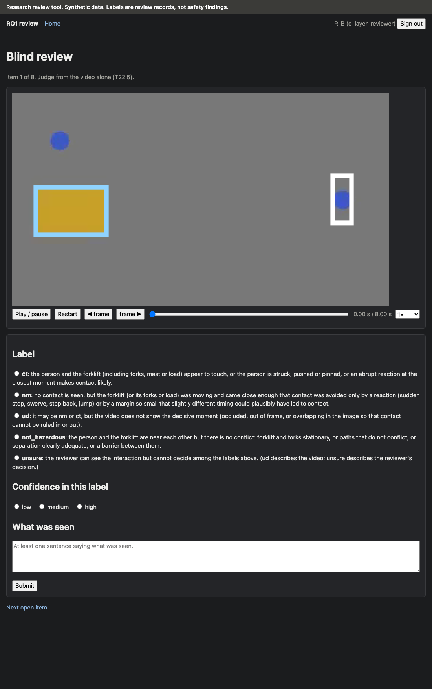

# V-02 report: T22 blind review application (part A)

Branch `v02-review-ui`. Contract E-1.2.20 (Appendix T section T22; Owner decision D-44, option (a), 19 Nov 2026).
Status: **implemented** and **verified on fixtures** (77 application and protocol tests, 2 held-data tests). Not used for any research result. Synthetic data only; any result from it is at most experimental (T12.5).

## In short

- A local web application on `http://127.0.0.1:8765/` for the T22 C-layer blind review:
  - Owner setup of annotator rows;
  - seeded pilot and reference batches;
  - the blind reviewer screen;
  - adjudication and the tier-1 audit;
  - status entries;
  - the agreement panel.
- It reads the S5 artifacts of the T-21 SDG validation run (configuration BL-6, validation partition) as its sampling frame. It runs no stage.
- Records go to a validation store under `out/review/<name>/` (git-ignored). Nothing is written to any analysis artifact.
- Five readings in T22 would change a number. The tool uses a provisional reading for each, recorded in every batch manifest and raised as **CR-028**. Representation choices are **AR-61**.
- **Before the first real reference batch:** CR-028 should be decided (audit size, α units, later batches, pilot records, allocation under capping).

## How to run a batch end to end

All commands are run from the repository root, with the project `.venv`.

1. **Owner profile** (once per store):
   `PYTHONPATH=src .venv/bin/python -m rq1.review init --owner <pseudonym>`. It asks for the passphrase twice on the terminal.
2. **Start the application:**
   `PYTHONPATH=src .venv/bin/python -m rq1.review serve`. Open `http://127.0.0.1:8765/`.
   The server binds to 127.0.0.1 only, so other computers cannot reach it. It reads `out/m1a/run1/sdg` and refuses any recording that is not an SDG validation recording of the frozen X0b split.
3. **Annotators** (Owner → *Annotators*): create one row per person and role:
   - two `c_layer_reviewer` rows and one `adjudicator` row;
   - each with a pseudonym (never a real name), a qualification text (T22.2 c), the independence attestation (T22.2 a), and that person's local passphrase.
4. **Pilot** (Owner → *Batches*): seed, the two reviewers, the adjudicator, tick *Pilot*.
   - The pilot draws n_pilot = 20 targets.
   - Both reviewers and the adjudicator review it together and discuss it.
   - Pilot assessments are stored. No adjudication, status entry, audit or agreement statistic is written for pilot targets (CR-028 item 4).
5. **Reference batch** (Owner → *Batches*): a new seed, same form, *Pilot* unticked.
   - The tool draws n_batch = 60 targets by T22.6 (a) and excludes the pilot targets.
   - It writes the immutable manifest (JCS JSON, `rvb_<uuid7>`).
6. **Blind review:** each reviewer signs in on the shared computer, opens *Blind review* and works through the items in their own seeded order.
   - Each item plays the recording's own video between the T22.4 start and end, with no marker of the interval.
   - The reviewer chooses one of the five labels (definitions as T22.5 a), a confidence (low, medium, high = 1.0, 2.0, 3.0) and a rationale.
   - When both reviewers have the same label and neither said `unsure`, the tool writes the tier-1 adjudication and its status entry at once (T22.7 a, T22.8).
7. **Audit:** when every target has both assessments, the tool draws the audit sample: ceil(0.10 × tier-1 targets), CR-028 item 1.
   - The adjudicator assesses these targets blind under *Blind review*.
   - If the adjudicator's label differs, the target reopens for adjudication. The tier-1 record stays.
8. **Adjudication:** the adjudicator opens *Adjudication*. Each waiting case shows:
   - the clip;
   - both assessments (label, confidence, rationale, no names);
   - the adjudicator's own audit assessment, where there is one.

   The adjudicator records the final label (tier 2, method adjudicator). Without an adjudicator, the two reviewers record a consensus-meeting label after both have finished the batch (T22.7 c).
9. **Agreement panel** (Owner → batch → *Agreement panel*) opens when the batch is fully adjudicated. *Status log check* verifies the hash chain (CT-E-24).

Sign-in separates the sessions of people who share the computer. It is **not a security boundary**: anyone with access to the user account can read `out/review/`. Passphrases are stored salted and hashed (PBKDF2-SHA256), in the store, outside git.

## Screenshots (fixtures)

All screenshots come from `research/review_ui/make_demo.py`. They show:
- a fixture store;
- the synthetic fixture video (shapes on a grey floor, two "persons" and one "forklift", so the T22.4 outlines apply);
- the FX-13 annotator rows;
- eight fixture targets, run end to end through the application.

The review times on the panel are near zero because the demo is scripted.

| Page | File |
|---|---|
| Sign-in | `screenshots/01_sign_in.png` |
| Owner: annotator rows | `screenshots/02_owner_annotators.png` |
| Owner: batches and the batch form | `screenshots/03_owner_batches.png` |
| Reviewer: blind item (clip, outlines, controls, definitions) | `screenshots/04_reviewer_item.png` |
| Adjudicator: case with both assessments | `screenshots/05_adjudication_case.png` |
| Owner: agreement panel | `screenshots/06_owner_agreement.png` |
| Owner: status log check | `screenshots/07_owner_status_log.png` |

## What the application enforces

| Rule | Where | Test |
|---|---|---|
| Reference assessments are blind; `shown_system_output = true` is refused (VR-E-053) | `store.submit` | `test_fx13d_unblind_reference_assessment_is_refused` |
| Exposure rule: a candidate_review assessment on any target of the recording excludes that person from reference assessment and adjudication (T22.2 b) | `store.exposed` | `test_fx13c_…`, `test_exposed_adjudicator_cannot_adjudicate` |
| Labels, confidence {1.0, 2.0, 3.0}, rationale required (T22.5) | `protocol.check_*` | `test_confidence_and_rationale_are_checked_through_the_form` |
| One assessment per (annotator, target, namespace); corrections name the replaced one (T22.5 e) | `store.submit` | `test_a_correction_…`, `test_a_reviewer_cannot_assess_a_target_twice_…` |
| Tier rule, methods, assessment_ids (T22.7) | `store._after_assessment`, `adjudicate`, `consensus` | FX-13, FX-13a, FX-13b, FX-13e |
| reference_class independent_expert_judgment, else ERR-SPEC (T22.9) | `store._reference_class` | `test_fx13f_…` |
| Status entries: mapping, config_id, layer C, basis = the adjudication; none for ref_event (T22.8, T22.3 c) | `store._write_adjudication` | FX-13 to FX-13e, `test_ref_event_target_writes_no_status` |
| Allocation, draw, manifest, per-reviewer order (T22.6) | `protocol.allocate`, `draw`, `reviewer_order` | `test_allocation_*`, `test_batches_follow_the_allocation_…`, `test_per_reviewer_order_…` |
| A reviewer never sees a system label, flag, value, route, status, configuration, stratum or another person's record (T22.4) | `server` pages and `/api/item` | `test_reviewer_pages_and_json_carry_no_system_output`, `test_second_reviewer_never_sees_the_first_assessment` |
| Agreement panel: Owner only, after full adjudication (T22.10) | `server.get_agreement` | `test_agreement_panel_only_after_full_adjudication`, `test_owner_pages_are_owner_only` |
| 127.0.0.1 only; no network URL; banner on every page; wording rules W1–W6 | `server` | `test_server_binds_to_localhost_only`, `test_every_page_has_the_banner_and_no_network_url` |
| No S5 or S8 run entry point is imported (only the κ / α functions) | static check | `test_review_package_imports_no_s5_or_s8_entry_point` |

Every T22 fixture (FX-13, FX-13a to FX-13f) runs through the application's own path: sign-in, the reviewer and adjudicator pages, their form posts, the store and the status log. Expected values come from the committed fixture files. The fixtures were built on `m0-implementation` with values retyped from T22.

## Data scope (T22.11)

- **Sampling frame:** the 319 BL-6 episodes of the T-21 SDG validation run, all under one rule configuration. Strata: CT 7, UD 44, NM 30, PC 212, H 17, O 9.
- **Excluded:** the test partition, SmartSpaces, real footage and Safe and Unsafe Behaviours.
- **No outlines on real batches:** every SDG validation recording has exactly one person and one forklift track, so no T22.4 outline is drawn on them. Outlines are exercised by the fixture video only.

## Provisional readings and open points

- **CR-028:** five readings that change a number (listed in the CR). Every manifest records them under `provisional_readings`, and the panel labels the α row as provisional. A second non-pilot batch on the same configuration and partition is refused until item 3 is decided.
- **AR-61:** eleven representation choices, for review.
- **EV-M12 (T22.10 b):** not implemented here. The panel covers T22.10 (a) and (c) only.
- **Original V-02 task text:** it was not on this computer (it was given in a cloud session). Its constraints were taken from the V-02 compatibility audit:
  - fixture and synthetic data only;
  - reuse of the schema validators, VR-E-053 guard, StatusLog and κ / α functions;
  - methods agreement, consensus_meeting and adjudicator;
  - the static import check.

  T22 replaces the earlier banner text. The Owner may want to check items 3 to 7 of that text against this report.
- **The candidate_review namespace (T23):** no screen. The store can hold such records so that the exposure rule can be enforced.
EOF
.venv/bin/python -c "
import sys; sys.path.insert(0,'src')
from rq1.export.report import lint; print(lint(open('research/review_ui/V-02_report.md').read()))"